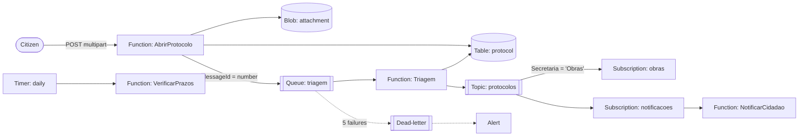

# Protocolo Digital

**[Live demo](https://jvcamargo10.github.io/protocolo-digital-azure/)** · [Leia em português](README.pt-BR.md)

A serverless system for citizens to file requests with a city hall (a pothole, a property-tax copy, a daycare
spot), attach a document and track the answer. Requests are routed automatically to the right department, each
with a response deadline.

> The GitHub Pages demo runs in the browser with fictitious data and shows, step by step, which Azure resource
> handled each part of the request. The real back-end is in this repository.

## Stack

| Layer | Technology |
|---|---|
| Compute | Azure Functions, .NET 10 isolated worker (HTTP, Service Bus queue/topic and timer triggers) |
| Messaging | Azure Service Bus: queue with duplicate detection and dead-lettering, topic with SQL-filtered subscriptions |
| Data | Azure Table Storage (protocols, yearly counter), Azure Blob Storage (attachments) |
| Security | Managed Identity + RBAC, shared keys disabled on Storage and Service Bus |
| Infrastructure | Bicep (Flex Consumption plan, Storage, Service Bus, Log Analytics, Application Insights, alerts) |
| Tests | xUnit, in-memory fakes, `FakeTimeProvider`, Azurite for Table/Blob integration tests |
| Front-end | React 19, TypeScript, Vite, Vitest |
| CI/CD | GitHub Actions: tests with Azurite, `bicep build`, Pages deploy |

## Flow



## Technical decisions

**Why a queue between submission and routing.** The HTTP function only validates, stores and enqueues, so the
citizen gets a protocol number in milliseconds even if routing is slow or temporarily failing. Routing retries on
its own; after 5 failures the message goes to the dead-letter queue, which has an alert.

**Duplicate-safe at every step.** The queue has duplicate detection and the message id is the protocol number, so
re-sending the same number within the window does not create a second message. The routing function is idempotent
anyway: a protocol that is no longer "Received" is skipped (Service Bus delivers at least once). Event ids are
`number:type`, and the topic also has duplicate detection.

**Recovering from a failure between storing and enqueuing.** If Service Bus is unavailable right after the
protocol is saved, the request still succeeds and the protocol stays "Received". The daily check re-enqueues any
protocol that has been "Received" for more than 10 minutes. This is a lighter alternative to an outbox, made safe
by the duplicate detection above.

**Gap-free yearly numbers without a database lock.** Numbers look like `2026/000123`. The counter is a Table entity
updated with optimistic concurrency: read the value and its ETag, write value + 1 with `If-Match`. If two function
instances race, one gets HTTP 412 and retries with jitter. An integration test fires 25 parallel requests against
Azurite and checks the result is exactly 1..25.

**Table Storage keys designed for the main query.** PartitionKey = year and RowKey = zero-padded sequence, so
looking up a protocol by number is a point read, the cheapest Table operation. Listing by department scans the
table; at higher volume the next step would be an index table keyed by department, written alongside.

**Optimistic concurrency on updates too.** Every protocol carries its ETag. If the department and the daily job
update the same protocol at once, the second write fails with a conflict (HTTP 409 on the API) instead of silently
overwriting.

**Attachments validated by content.** The file type comes from its first bytes (PDF, PNG, JPEG signatures), not from
the extension, so a renamed executable is rejected. File names are sanitized, the container is private, blobs are
never overwritten (`If-None-Match: *`), and a SHA-256 hash is stored as proof of integrity.

**No secrets in production.** Storage shared keys and Service Bus local auth are disabled. The Function App uses
its system-assigned Managed Identity with only the roles it needs; settings like
`ServiceBus__fullyQualifiedNamespace` tell the runtime to authenticate with that identity. Locally, connection
strings for Azurite and the Service Bus emulator are used instead.

**Topic subscriptions per department.** The routing function publishes one event; Service Bus delivers it to the
department's subscription (SQL filter on the `Secretaria` property) and to the notification subscription. Adding a
new consumer (a BI export, for example) is a new subscription with no change to the publisher.

## Running locally

```bash
npx azurite --silent --skipApiVersionCheck &        # Blob and Table emulator
cd backend && dotnet test ProtocoloDigital.slnx     # unit + Azurite tests

# Running the Functions also needs the Service Bus emulator and Azure Functions Core Tools:
cp src/ProtocoloDigital.Functions/local.settings.example.json src/ProtocoloDigital.Functions/local.settings.json
cd src/ProtocoloDigital.Functions && func start

cd frontend && npm install && npm run dev            # demo UI
```

Deploying:

```bash
az group create -n protocolo-digital -l brazilsouth
az deployment group create -g protocolo-digital -f infra/main.bicep -p emailAlertas=you@example.com
func azure functionapp publish <function-app-name>
```

## Project layout

```
backend/
  src/ProtocoloDigital.Core/Dominio      rules, use cases and ports (no Azure dependency)
  src/ProtocoloDigital.Core/Infra        Table, Blob and Service Bus adapters
  src/ProtocoloDigital.Functions         Azure Functions (HTTP, queue, topic, timer)
  tests/ProtocoloDigital.Testes          xUnit tests
infra/main.bicep                         Azure infrastructure
frontend/                                React demo; src/demo.ts simulates the back-end
```
