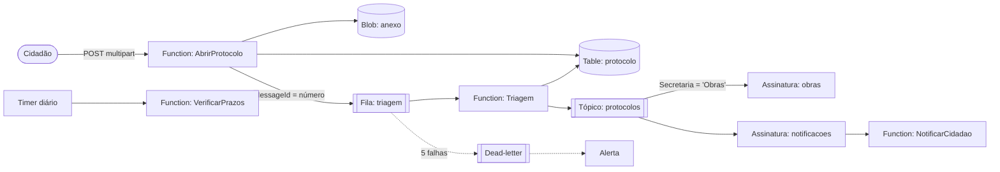

# Protocolo Digital

**[Demo ao vivo](https://jvcamargo10.github.io/protocolo-digital-azure/)** · [Read in English](README.md)

Sistema serverless para o cidadão abrir pedidos na prefeitura (um buraco na rua, segunda via do IPTU, vaga em
creche), anexar um documento e acompanhar a resposta. Os pedidos vão automaticamente para a secretaria certa, cada
uma com seu prazo de resposta.

> A demo no GitHub Pages roda no navegador, com dados fictícios, e mostra passo a passo qual recurso do Azure tratou
> cada parte do pedido. O back-end real está neste repositório.

## Stack

| Camada | Tecnologia |
|---|---|
| Computação | Azure Functions, .NET 10 isolated worker (gatilhos HTTP, fila e tópico do Service Bus, timer) |
| Mensageria | Azure Service Bus: fila com detecção de duplicidade e dead-letter, tópico com assinaturas filtradas por SQL |
| Dados | Azure Table Storage (protocolos, contador anual), Azure Blob Storage (anexos) |
| Segurança | Managed Identity + RBAC, chaves compartilhadas desativadas no Storage e no Service Bus |
| Infraestrutura | Bicep (plano Flex Consumption, Storage, Service Bus, Log Analytics, Application Insights, alertas) |
| Testes | xUnit, dublês em memória, `FakeTimeProvider`, Azurite para testes de integração de Table/Blob |
| Front-end | React 19, TypeScript, Vite, Vitest |
| CI/CD | GitHub Actions: testes com Azurite, `bicep build`, deploy no Pages |

## Fluxo



## Decisões técnicas

**Por que uma fila entre a abertura e a triagem.** A Function HTTP só valida, grava e enfileira: o cidadão recebe o
número em milissegundos, mesmo que a triagem esteja lenta ou falhando no momento. A triagem tenta de novo sozinha;
depois de 5 falhas, a mensagem vai para a dead-letter queue, que tem alerta.

**Seguro contra duplicidade em todas as etapas.** A fila tem detecção de duplicidade e o id da mensagem é o número
do protocolo: reenviar o mesmo número dentro da janela não cria uma segunda mensagem. A triagem é idempotente de
qualquer forma: um protocolo que já não está "Recebido" é ignorado (o Service Bus entrega "pelo menos uma vez").
O id dos eventos é `número:tipo`, e o tópico também detecta duplicidade.

**Recuperação de falha entre gravar e enfileirar.** Se o Service Bus cair logo depois de o protocolo ser gravado, o
pedido continua dando certo e o protocolo fica "Recebido". A verificação diária reenfileira o que estiver
"Recebido" há mais de 10 minutos. É uma alternativa mais leve que uma outbox, segura graças à detecção de
duplicidade.

**Número anual sem buracos e sem lock de banco.** O formato é `2026/000123`. O contador é uma entidade da Table
atualizada com concorrência otimista: lê o valor e o ETag e grava valor + 1 com `If-Match`. Se duas instâncias da
Function disputarem, uma recebe HTTP 412 e tenta de novo, com espera aleatória. Um teste de integração dispara 25
pedidos em paralelo contra o Azurite e confere que o resultado é exatamente 1..25.

**Chaves da Table pensadas para a consulta principal.** PartitionKey = ano e RowKey = sequência com zeros à
esquerda: buscar um protocolo pelo número é uma leitura pontual, a operação mais barata da Table. Listar por
secretaria varre a tabela; com volume maior, o próximo passo seria uma tabela-índice com a secretaria como chave,
gravada junto.

**Concorrência otimista também nas atualizações.** Cada protocolo carrega o seu ETag. Se a secretaria e a rotina
diária alterarem o mesmo protocolo ao mesmo tempo, a segunda gravação falha com conflito (HTTP 409 na API), em vez
de sobrescrever em silêncio.

**Anexo validado pelo conteúdo.** O tipo vem dos primeiros bytes (assinaturas de PDF, PNG e JPEG), não da extensão:
um executável renomeado é recusado. O nome do arquivo é sanitizado, o container é privado, o blob nunca é
sobrescrito (`If-None-Match: *`) e o SHA-256 fica guardado como prova de integridade.

**Nenhum segredo em produção.** As chaves compartilhadas do Storage e a autenticação local do Service Bus estão
desativadas. A Function App usa a Managed Identity com só os papéis de que precisa; configurações como
`ServiceBus__fullyQualifiedNamespace` dizem ao runtime para autenticar com essa identidade. Localmente, são usadas
as connection strings do Azurite e do emulador do Service Bus.

**Uma assinatura do tópico por secretaria.** A triagem publica um único evento; o Service Bus entrega para a
assinatura da secretaria (filtro SQL na propriedade `Secretaria`) e para a de notificações. Um consumidor novo
(uma exportação para BI, por exemplo) é só mais uma assinatura, sem mudar quem publica.

## Rodando localmente

```bash
npx azurite --silent --skipApiVersionCheck &        # emulador de Blob e Table
cd backend && dotnet test ProtocoloDigital.slnx     # testes de unidade e com Azurite

# Rodar as Functions também exige o emulador do Service Bus e o Azure Functions Core Tools:
cp src/ProtocoloDigital.Functions/local.settings.example.json src/ProtocoloDigital.Functions/local.settings.json
cd src/ProtocoloDigital.Functions && func start

cd frontend && npm install && npm run dev            # interface da demo
```

Implantação:

```bash
az group create -n protocolo-digital -l brazilsouth
az deployment group create -g protocolo-digital -f infra/main.bicep -p emailAlertas=voce@exemplo.com
func azure functionapp publish <nome-da-function-app>
```

## Estrutura

```
backend/
  src/ProtocoloDigital.Core/Dominio      regras, casos de uso e portas (sem dependência do Azure)
  src/ProtocoloDigital.Core/Infra        adaptadores de Table, Blob e Service Bus
  src/ProtocoloDigital.Functions         Azure Functions (HTTP, fila, tópico, timer)
  tests/ProtocoloDigital.Testes          testes xUnit
infra/main.bicep                         infraestrutura no Azure
frontend/                                demo em React; src/demo.ts simula o back-end
```
